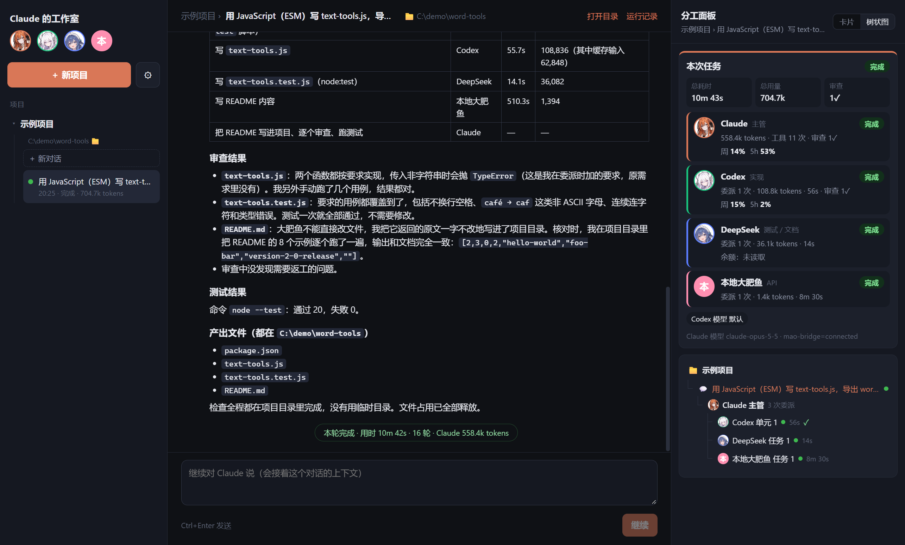
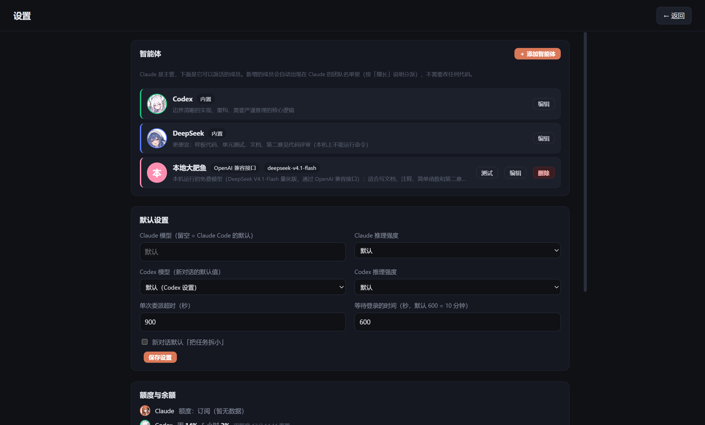
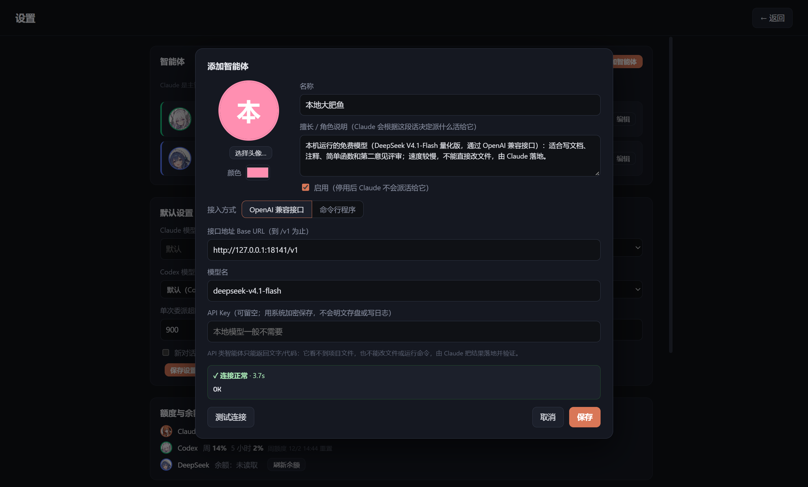

# Claude 的工作室

让 **Claude Code 当主管**，把一个开发任务拆开，分派给 **OpenAI Codex**、**DeepSeek Harness (dsh)** 以及你自己添加的其他智能体去做，然后由 Claude 审查代码、跑测试、返工，最后给出“谁做了什么”的总结。

有两种用法：**桌面版**（推荐）和**命令行**。



## 安装（桌面版）

1. 下载或自己构建安装包 `ClaudeStudio-Setup-<版本>.exe`（构建方法见文末「从源码构建」）。
2. 双击安装。安装包是**按用户安装**的，不需要管理员权限；默认装到 `%LOCALAPPDATA%\Programs\ClaudeStudio`，会在开始菜单和桌面创建「Claude 的工作室」快捷方式。
3. 需要这台电脑上已经有（都用各自官方的方式安装并登录）：
   - **Claude Code**（`claude` 命令，已登录）——主管；
   - **Codex 桌面版**（已用 ChatGPT 登录）——应用会自动找到里面的 `codex.exe`；
   - **DeepSeek Harness**（可选）+ 用户环境变量 `DEEPSEEK_API_KEY`。
   找不到时左上角对应的头像会变灰，鼠标悬停能看到原因；也可以用环境变量 `CLAUDE_PATH` / `CODEX_PATH` / `DSH_PATH` 指定位置。
4. 数据（项目、对话记录、看板、智能体配置、设置）保存在 `%APPDATA%\Claude 的工作室\`，卸载时不会删除。开发版和安装版共用这份数据。

开发时也可以不安装，直接从源码启动：

```powershell
powershell -ExecutionPolicy Bypass -File .\scripts\start-desktop.ps1
```

（第一次运行会自动安装依赖、下载 Electron、编译，全部装在项目目录里。）
界面分三栏：

- **左栏**
  - 应用名下面是三个圆形头像，表示在线状态：灰色 = 不可用（没装、没登录或缺 key），亮起 = 在线，外圈闪动 = 正在某个对话里干活。鼠标停在头像上能看到额度/余额。Claude 头像右下角的红点 = bridge 没编译。
  - 「＋ 新项目」：起个名字，选一个文件夹（空文件夹也行），或者在某个上级文件夹里「新建文件夹」。
  - 项目可以折叠展开，每个项目下有多个对话和「＋ 新对话」。一个项目的所有对话都在它的文件夹里工作。
  - 项目行右边（鼠标悬停时）有：＋ 新对话、✎ 重命名、✕ 从列表移除。**移除只是从列表隐藏，不会删除磁盘上的任何文件**，对话记录也都还在。
  - 对话前的圆点：黄 = 运行中，紫 = 正在排队等别的对话，绿 = 完成，红 = 失败。
- **中栏**：和 Claude 的对话。
  - Claude 的计划和总结按 Markdown 显示；读文件、跑命令显示成灰色小行。
  - 每次委派是一个带头像的块，运行中实时显示对方在做什么（执行哪条命令、改哪个文件）；展开能看完整的子任务和对方的回复。
  - 任务结束后，可以在输入框里继续对 Claude 说话，会接着原来的上下文。
  - 运行中可以点「■ 停止」，会结束整棵进程树（claude、bridge、codex/dsh）。
- **右栏「分工面板」**：顶部写着「项目 › 对话」，可在「卡片」和「树状图」之间切换。
  - Claude 主管卡：总耗时、本次用量（tokens）、审查通过数、Claude 周额度、各成员 token 合计、本次选项。
  - 每次委派一张卡（Codex 单元 1、DeepSeek 任务 1、Codex 修复 #2…）：状态、实时耗时、Tokens、改动文件、过程记录、Claude 的审查结论；Codex 卡显示 Codex 额度，DeepSeek 卡显示账户余额。
  - 树状图：项目 › 对话 › Claude 主管 › 各次委派（返工的委派嵌套在原委派下面）；同一项目里其他正在运行的对话显示成并列分支。点节点会跳到对应卡片和对话里的位置。
  - 「项目动态」：同项目其他对话在做什么、占用了哪些文件、留言和 Claude 的优先级判定。

### 同一项目的多个对话

同一项目的对话共用一个文件夹，可能同时改到同一个文件。办法是一块**项目看板**（`%APPDATA%\Claude 的工作室\data\boards\<项目>\board.json`，不放进你的项目文件夹；带文件锁）：

- 每个对话的标题、目标、状态、当前进度、占用的文件、留言都记在看板上，应用会根据输出自动更新状态和进度。
- Claude 多了这些工具：`project_status`（看别的对话）、`claim_files` / `release_files`（占用/释放文件）、`wait_for_files`（排队，对方释放后自动继续）、`post_note` / `read_notes`（留言）。
- 规则（写在 CLAUDE.md 和系统提示里）：开始先看看板 → 改文件或委派前先占用 → 撞上别的对话时**由 Claude 判断优先级**（紧急程度、依赖、谁先开始、对方进度），选择排队、先做别的部分或留言协商，并把决定和理由写成「优先级判定」留言。
- 每次委派结束后，bridge 会检查改动的文件是否碰到别的对话占用的文件，碰到就在结果里加 🚩 CONFLICT，Claude 必须处理。
- 对话结束时，应用会自动释放它占用的所有文件。
- 别的对话发来的留言和判定会作为系统消息出现在对话里。

### 登录失效时自动恢复

- 启动时用 `codex login status` / `claude auth status` 检查登录（只看是否已登录，不读取任何 token）。
- 每次委派给 Codex 前，bridge 也会检查；执行中如果报出认证类错误（401、token 过期等），会再检查一次。
- 发现没登录时：
  1. Codex 头像变灰，提示「需要登录」。
  2. 应用自动运行 `codex login`，它会在浏览器里打开登录页；同一时间只会有一个登录进程。
  3. 中栏顶部出现提示条，有「重新打开登录页」和「取消」两个按钮。
  4. 待执行的 Codex 委派不会失败，而是排队等待，卡片上显示「⏸ 等待 Codex 登录」。
  5. 登录完成后（每 3 秒检查一次），头像重新亮起，排队的委派自动继续。
- 等待超过 10 分钟或被取消时，委派会带着说明返回，由 Claude 决定改派给 DeepSeek、自己做，还是稍后重试，并告诉你。
- Claude Code 的登录同理：检测到未登录会运行 `claude auth login`。如果对话因为认证失败中断，重新登录后在对话里点「继续」即可。
- 测试时可以设置环境变量 `MAO_SIM_CODEX_LOGGED_OUT=<文件路径>`：这个文件存在期间，应用当作 Codex 未登录处理，也不会打开浏览器。

### 额度与余额（数据来源）

| 显示 | 来源 | 说明 |
|---|---|---|
| Claude 周额度 / 5 小时额度 | `claude -p --output-format stream-json` 输出里的 `rate_limit_event`（`seven_day` / `five_hour` 的 utilization 和重置时间） | 只在有对话运行时更新；启动时用最近一次记录。 |
| Codex 周额度 / 5 小时额度 | `codex app-server` 的 `account/rateLimits/read`（secondary = 周，primary = 5 小时） | 启动时、每次 Codex 委派结束后、每 10 分钟刷新。 |
| DeepSeek 余额 | 官方接口 `GET https://api.deepseek.com/user/balance`（用 DEEPSEEK_API_KEY，不写日志） | 启动时和每次 DeepSeek 委派结束后刷新。 |
| 每个对话的用量 | Claude：每轮 `result` 的 usage；Codex / DeepSeek：bridge 返回的 tokens（DeepSeek 运行中也会实时累计） | Claude 和 Codex 是订阅制，所以不显示金额。 |

最近一次读到的值缓存在 `%APPDATA%\Claude 的工作室\data\quota.json`。

模型和选项（在输入框下方，新对话会记住上次的选择）：

| 选项 | 作用 |
|---|---|
| Claude 模型 | 主管 Claude 用的模型（`--model`：Opus / Sonnet / Fable / Haiku）；默认值来自 设置 → 默认设置 |
| Claude 思考 | Claude 的思考等级（`--effort`：低 … 最高）；默认值来自设置 |
| 把任务拆小 | 让 Claude 把 Codex 的工作拆成几分钟能完成的小单元，每个单元审查通过后再委派下一个 |
| Codex 模型 | 列表来自 `codex debug models`；「默认」= 用 Codex 自己的设置 |
| 推理强度 | Codex 的 reasoning effort；可选项随模型变化 |

这些选项按对话保存，显示在右侧总览卡片上；对话进行中也可以在输入框下方切换，从下一条消息开始生效。输入框下方只显示一行小标签（例如「Claude Sonnet · 低」「Codex 默认」「拆小 ✗」），点开是选择面板；窗口较窄时收成一个「⚙ 模型」按钮，所有选项在同一个面板里。

### 附件（图片和文件）

- 在输入框里 **Ctrl+V** 粘贴截图或在资源管理器里复制的文件，或者把文件**拖进**输入框，或点左下角 **＋ → 添加文件**。发送前显示为缩略图 / 文件卡片，可以点 × 移除；发出去的消息里也会显示，图片可以点开放大。
- 图片 ≤ 20 MB（png / jpg / gif / webp 会作为真正的图片直接发给 Claude），其他文件 ≤ 50 MB（Claude 用 Read 读取，PDF 也可以），一次最多 20 个。
- 附件复制到 `%APPDATA%\Claude 的工作室\attachments\<对话编号>\`（保留原文件名），**不会放进项目文件夹**；这个文件夹通过 `--add-dir` 交给 Claude，续聊时以前的附件也能读。
- 委派时 Claude 会把附件路径写进任务：Codex 可以读这个文件夹，图片还能通过 `images` 参数直接给 Codex 看；DeepSeek 的沙箱会额外放行这个文件夹（`--add-dir`）；其他智能体由 Claude 把需要的内容写进任务。

### 添加文件路径（原地交给智能体，不复制）

- 点输入框左下角 **＋** → **添加文件夹路径 / 添加文件路径**（弹出选择框），或 **输入或粘贴路径**（回车添加）。路径**不会被复制**，各位智能体直接在原位置读取，适合项目文件夹以外的资料、大文件夹、另一个仓库。
- 每个路径显示为输入框上方的一个标签「📁 路径 [只读] ×」：点「只读 / 可修改」切换（默认**只读**，改成可修改前会确认），点 × 移除。路径跟着对话保存（右侧总览卡片上也会列出），续聊时一直有效；进行中改动从下一条消息开始生效。
- 各位智能体怎么拿到权限：
  - **Claude**：用权限规则放行读取（`Read(路径/**)`）；只读路径同时加上 Edit / Write 的禁止规则，改动会被 Claude Code 直接拒绝。Claude 每一轮都会被告知这些路径和读写模式。
  - **Codex**：本来就能读工作区以外的文件；可修改的路径通过 `--add-dir` 加成可写目录，只读路径在它的沙箱里写不进去（只读路径在 %TEMP% 里时，会关掉沙箱对临时目录的默认写权限）。
  - **DeepSeek**：可修改的路径通过 dsh 的 `--add-dir` 放进沙箱（如果它报 `SANDBOX_ACL`，需要用卡片上的「授予 DeepSeek 沙箱权限」按钮，应用不会悄悄改权限）；只读路径写入会被沙箱拒绝（只读路径在 %TEMP% 里时，DeepSeek 改用自己的临时目录）。
  - **Gemini CLI**：通过 `--include-directories` 传入（参数模板里的 `{dirs}`）。注意：Gemini 对只读路径只有提示约束，没有硬性拦截（它的 --include-directories 不区分读写），Claude 也被告知不要让它改只读路径。
  - **API 智能体**（如本地大肥鱼）：不能直接读文件，由 Claude 把需要的内容写进任务。
- 安全：太宽的路径（磁盘根目录、C:\Windows、Program Files、ProgramData、用户主目录、AppData）添加前会提醒；存放凭据的文件夹（.ssh、.gnupg、.aws、.azure、.kube、.docker、.claude、.codex、.dsh、.gemini、浏览器配置、Windows 凭据等，以及本应用的数据文件夹）会直接拒绝。

### 任务中发消息引导

Claude 工作时输入框不再锁住，可以随时补充或纠正方向：

- **引导**（Ctrl+Enter）：不打断，Claude 做完当前这一步就会看到这条消息并调整计划。消息在对话里显示为虚线气泡，标着「任务中引导」和状态（等 Claude 做完当前这一步 → ✓ 已送达）。可以带图片和文件。
- **打断并改向**：立刻停止当前这一轮（保留对话上下文），然后按这条消息继续。适合方向完全错了、不想等它做完当前步骤的时候。
- **■**：停止任务。
- 引导送到时如果有委派正在运行（Codex / DeepSeek 等），这次委派会**转到后台继续跑**，先把控制权交还给 Claude：Claude 看完引导后决定继续等它（`wait_delegation`），还是取消（`cancel_delegation`）并按新要求重新委派。被取消的委派在卡片和树状图上显示「已取消（因引导）」。
- 如果引导到达时这一轮刚好在收尾，它会排队，本轮结束后自动作为下一条消息发出（显示「排队中，本轮结束后送达」）。

### DeepSeek 执行命令（受 Claude 监管）

DeepSeek 现在可以跑构建 / 测试等命令（设置 → DeepSeek 执行命令，默认开启）：

- **沙箱是硬边界**：命令在 dsh 自己的 Windows 沙箱里运行，只能写项目文件夹和本对话的附件文件夹，写别处会被系统拒绝。
- **逐条监管**：bridge 检查 DeepSeek 报出的每条命令，卡片上实时显示 ✓ 允许 / ❓ 需复查 / ⛔ 拦截。拦截类（改注册表、服务、计划任务、权限、环境变量，关机，格式化，下载后执行，读凭据文件，git push / 发布，递归删除工作目录以外或整个工作目录）会**立刻终止** DeepSeek，这次委派算失败。需复查类（联网下载、安装全局工具、启动外部程序、工作目录以外的路径、改写 git 历史）照常受沙箱限制，记录交给 Claude 审查。
- **Claude 审查**：完整命令清单随委派结果交给 Claude；它审查时必须看这份清单，可疑的会单独提醒你，被拦截的命令不会换个方式再跑。
- dsh headless 没有逐条命令的审批接口，所以「拦截」是发现后立刻结束进程，而不是事前暂停；真正挡住越界写入的是沙箱。
- **沙箱权限**：dsh 的沙箱需要你对项目文件夹有「完全控制」权限。用户文件夹（`C:\Users\<你>\…`）下的项目一般已经有；其他磁盘上的文件夹常常只有「修改」，这时 DeepSeek 的卡片上会出现 **「授予 DeepSeek 沙箱权限」**，点一下（等于 `icacls <项目文件夹> /grant <你>:(OI)(CI)(F)`，只影响这个文件夹）；设置页里也能逐个项目检查和授予。

环境有问题时（例如 bridge 没编译、找不到 Codex、缺少 DeepSeek key），中栏顶部会出现黄色提示，bridge 没编译可以直接点「编译 bridge」。

每次运行的完整记录在 `%APPDATA%\Claude 的工作室\runs\<编号>\`（界面上点「运行记录」可直接打开）：

| 文件 | 内容 |
|---|---|
| `meta.json` | 任务、所属项目、工作目录、选项、状态、各成员 tokens |
| `events.jsonl` | 界面显示用的事件（历史任务就是从这里回放的） |
| `claude.jsonl` | Claude 的原始 stream-json 记录 |
| `*_codex.jsonl` / `*_deepseek.jsonl` | 每次委派一个文件：对方的全部事件和结果 |

### 关闭窗口：缩到托盘

- 点窗口右上角的 **×** 不会退出，而是缩到屏幕右下角的托盘（通知区域），正在运行的任务继续跑。第一次会弹一条通知提醒。
- **单击托盘图标**：打开 / 隐藏窗口。有任务在运行时，托盘图标右下角有一个绿点，鼠标悬停显示「N 个任务进行中」。
- **右键托盘图标**：显示主窗口、新对话、（有新版本已下载时）重启并更新、退出。也可以在窗口里按 **Ctrl+Q** 退出。有任务在运行时退出会先确认（停止的对话之后可以接着继续）。
- 窗口隐藏或不在前台时，任务完成、失败、某个智能体需要登录、DeepSeek 需要授予沙箱权限，都会弹出 Windows 通知；点通知直接打开对应的对话。
- 应用已经在托盘里时，再双击桌面快捷方式会打开已有的窗口，不会再开一个。
- 不想要这个行为：设置 → 窗口 → 取消「关闭窗口时最小化到托盘」，× 就会直接退出。

### 头像

角色图片在 `apps/desktop/src/renderer/src/assets/avatars/`（`full/` 里是全身原图）：Claude = 橙发拿书的女孩，Codex = 白发龙娘，DeepSeek = 蓝发鲸鱼女仆，Gemini = 蓝紫发带星星的猫娘，本地大肥鱼 = Q 版鲸鱼女仆（`dafeiyu.png`）。替换同名文件后重新编译即可。Gemini 和本地大肥鱼是在设置里添加的智能体，头像要在「编辑」里选对应的图片设置。

## 工作原理

```
你 ──任务──> 桌面版 / scripts/run-task.ps1
               │  claude -p（主管：规划 / 审查 / 测试 / 总结）
               │      │ MCP（stdio）
               ▼      ▼
         packages/bridge  ── delegate_to_codex ──>  codex exec --json -s <模式> -C <目录> -
                          └─ delegate_to_deepseek ─> dsh --profile headless --json --permission-mode workspace-write --approval-policy never -
```

- **bridge** 是一个本地 MCP 服务器，给 Claude 提供两个工具：
  - `delegate_to_codex { task, cwd, mode: "read-only" | "workspace-write", allowNetwork?, model?, reasoningEffort?, timeoutSec? }`（`allowNetwork: true` 让 Codex 沙箱能联网装依赖；model / reasoningEffort 不传时用环境变量 `MAO_CODEX_MODEL` / `MAO_CODEX_EFFORT`，再不行就用 Codex 自己的设置）
  - `delegate_to_deepseek { task, cwd, timeoutSec? }`（只能改 cwd 里的文件）
  - 返回：最终回答、改动了哪些文件（新增/修改/删除）、耗时、token 用量、错误信息、日志路径。
  - 任务通过 stdin 传入；超时会连同子进程一起杀掉（默认 900 秒）。
- **分工规则**写在 [CLAUDE.md](CLAUDE.md)：
  - Claude：规划、拆分、委派、**必须审查每个结果（读改动、跑测试）**、修正或打回、写总结；
  - Codex：边界清晰的实现和重构；
  - DeepSeek：更便宜的活——样板代码、测试、文档、第二意见评审。

## 前提

| 工具 | 说明 |
|---|---|
| Node.js 22+ | 已有 |
| Claude Code (`claude`) | 已登录，在 PATH 上 |
| Codex 桌面版 | 已用 ChatGPT 登录；bridge 会自动通过 `Get-AppxPackage OpenAI.Codex` 找到里面的 `codex.exe`，**不需要**加到 PATH |
| DeepSeek Harness | 已安装；自动找 `%LOCALAPPDATA%\Programs\DeepSeek Harness\resources\runtime\cli\bin\dsh.cmd` |
| `DEEPSEEK_API_KEY` | 用户环境变量。若当前终端没有，bridge 会在调用时从注册表 `HKCU\Environment` 读取（不会写进日志） |

如果自动查找失败，可以设置环境变量 `CODEX_PATH` / `DSH_PATH` 指向可执行文件。

## 安装（只需一次）

```powershell
cd <仓库目录>\packages\bridge
npm install
npm run build
npm run selftest   # 可选：分别让 Codex 和 DeepSeek 建一个小文件，确认两边都通
```

## 命令行用法

```powershell
cd <仓库目录>
.\scripts\run-task.ps1 "用 TypeScript 写一个命令行待办事项工具，支持 add/list/done，并配上单元测试"
```

不指定 `-Workdir` 时，默认在 `sandbox\demo` 里干活。对自己的项目：

```powershell
.\scripts\run-task.ps1 "给 utils 模块补单元测试" -Workdir D:\code\myproj
```

可选参数：

| 参数 | 作用 |
|---|---|
| `-Workdir <路径>` | 工作目录（不存在会创建） |
| `-Model <名字>` | 指定 Claude 模型，如 `opus` / `sonnet` |
| `-MaxBudgetUsd <数字>` | Claude 这一侧的花费上限（美元） |
| `-DelegateTimeoutSec <秒>` | 每次委派的默认超时，默认 900 |

如果 PowerShell 提示禁止运行脚本，用：

```powershell
powershell -ExecutionPolicy Bypass -File .\scripts\run-task.ps1 "你的任务"
```

运行时终端会实时显示：Claude 的计划和说明、每次委派（黄色 `-> Codex / DeepSeek`）、委派结果（绿色 `<- agent: ... status ... duration ...`）、Claude 自己的读文件/跑命令。

## 命令行日志

都在 `logs\`（已加入 .gitignore；桌面版的记录在 `logs\runs\`，见上文）：

| 文件 | 内容 |
|---|---|
| `<时间>_codex.jsonl` / `<时间>_deepseek.jsonl` | 每次委派一个文件：调用参数、对方的全部事件、stderr、最终结果（改动文件、耗时、token） |
| `<时间>_claude.jsonl` | Claude 主管的完整 stream-json 记录 |
| `<时间>_claude-summary.md` | 最终总结（含 Claude 侧耗时和费用） |
| `mcp.runtime.json` | 脚本自动生成的 MCP 配置 |

## 安全边界

- Claude 以 `dontAsk` 模式运行：只允许 bridge 工具、读写文件，以及 `npm / npx / node / git status / git diff` 等构建测试命令；其他命令一律被拒绝。白名单在 `config\claude-allowed-tools.json`，桌面版和命令行共用。
- 桌面版窗口开启了上下文隔离和沙箱，页面不能直接访问 Node；外部链接一律用系统浏览器打开。
- Codex 用 `-s read-only` 或 `-s workspace-write` 沙箱，只能写 cwd。
- DeepSeek 用 `workspace-write` 权限预设，工作区就是 cwd（外加本对话的附件文件夹）；它跑的每条命令都经过 bridge 的监管策略（`packages/bridge/src/cmdpolicy.ts`），危险命令会让它当场被终止。
- 不做全局安装，不改 PATH，不读密钥文件；API key 只在启动 dsh 时放进它的环境变量，日志里会被替换成 `***`。

## 目录结构

```
claude-studio/
├─ CLAUDE.md              分工规则（给主管 Claude 看）
├─ .mcp.json              在本目录直接运行 claude 时注册 bridge
├─ packages/bridge/       MCP bridge（TypeScript）
│  └─ src/  index.ts（MCP 服务器）agents.ts（Codex/dsh 调用与解析）registry.ts（自定义智能体）
│           runner.ts（进程/超时/日志）collab.ts + board.ts（同项目协作）auth.ts（登录恢复）
│           locate.ts（定位可执行文件和 key）snapshot.ts（统计改动文件）selftest.ts
├─ apps/desktop/          桌面版「Claude 的工作室」（Electron + React，electron-vite）
│  ├─ src/  main/（运行 claude、解析流、跟踪各智能体进度、存记录、智能体注册表、设置）
│  │        preload/（给页面的安全接口）renderer/（界面、设置页）shared/（类型）
│  └─ build/icon.ico      应用图标
├─ config/claude-allowed-tools.json   Claude 可用工具白名单
├─ scripts/
│  ├─ start-desktop.ps1   启动桌面版
│  └─ run-task.ps1        命令行运行
├─ docs/screenshots/      界面截图
└─ dist/                  安装包输出（npm run dist，不进 git）

运行时数据不在仓库里，在 %APPDATA%\Claude 的工作室\（项目、看板、智能体、设置、对话记录）。
```

## 已知限制

- **DeepSeek 的沙箱需要项目文件夹的「完全控制」权限**：没有时 dsh 报 `SetNamedSecurityInfoW failed (Win32 5)`，命令不会执行；应用会识别这个错误，在卡片上给出「授予 DeepSeek 沙箱权限」。
- **DeepSeek 的沙箱不允许带 IPC 的子进程**（`fork`）：`node --test` 默认会报 `spawn EPERM`，要用 `node --test --experimental-test-isolation=none`（已写进给它的提示）；jest / vitest 这类开 worker 的测试框架在它那里可能跑不了，这时由 Claude 来跑测试。
- Codex 沙箱默认不联网；需要 `npm install` 时 Claude 会传 `allowNetwork: true`（npm 缓存放在工作目录的 `.npm-cache`）。

- **任务中引导要等 Claude 做完当前这一步**：Claude 正在长时间思考或执行一条命令时，引导消息要等这一步结束才送到（委派除外：委派会转到后台，引导马上送到）。急的话用「打断并改向」。
- Claude Code 等待一次委派的上限由 `MCP_TOOL_TIMEOUT` 控制，脚本已设为“委派超时 + 2 分钟”。
- 改动文件是通过委派前后对目录做快照比较得出的（跳过 node_modules/.git/dist），超大目录会慢一点。
- dsh 会自动读取上级目录的 CLAUDE.md；bridge 在每个任务前加了“你是执行者、不要再委派”的说明，CLAUDE.md 顶部也写了这句。

## 设置与添加智能体

左下角的「⚙ 设置」打开设置页：




- **智能体**：列出 Claude 可以派活的成员。内置的 Codex、DeepSeek 不能删除，可以改名称、头像、颜色、擅长说明，或者停用。
- **各智能体默认模型**：每个成员（Claude、Codex、DeepSeek，以及你添加的智能体）默认用哪个模型、思考多深，改完立即保存，下次委派生效。
  - 模型可选「默认（由该智能体决定）」、列表里的模型或「自定义…」手动输入。DeepSeek 可选 deepseek-flash / deepseek-v4-pro；Gemini 列出常用型号（Pro 没有免费额度，默认用 Flash）；OpenAI 兼容接口的智能体会读取它的 `/models` 列表。
  - 思考等级：Claude、Codex、DeepSeek（关闭 / 低 / 中 / 高）、API 智能体（作为 `reasoning_effort` 发送）。命令行智能体要在参数模板里写 `{effort}` 才能设置，否则显示「不支持」。
  - 命令行智能体的模型通过参数模板里的 `{model}` 传入；留空时连同前面的 `-m` 一起省略。旧版本里写死在参数里的模型（例如 Gemini 的 `-m gemini-3-flash-preview`）会自动变成这里的默认模型。
  - Claude 和 Codex 还能在对话输入框下方按对话单独切换。分工卡片和树状图上会显示每次委派实际用的模型。
- **默认设置**：新对话是否默认「把任务拆小」、单次委派超时、等待登录的时间（默认 10 分钟）。
- **额度与余额**：Claude / Codex 的周额度和 5 小时额度，DeepSeek 余额（可手动刷新）。
- **数据与日志**：各个目录的位置，点「打开」直接在资源管理器里打开。
- **关于**：版本号。

### 添加一个智能体（不用改代码）



设置 → 智能体 →「＋ 添加智能体」：

1. **名称、头像、颜色**：头像选一张图片，会自动裁成圆形。
2. **擅长 / 角色说明**：这段话会写进 Claude 的「团队名单」，Claude 据此决定派什么活给它。写清楚它擅长什么、有什么限制（比如「慢」「只适合写文档」）。
3. **接入方式**，二选一：
   - **OpenAI 兼容接口**：填 Base URL（到 `/v1` 为止）、模型名、API Key（可留空）。Key 用 Windows 的系统加密（DPAPI）保存，不会明文存盘，也不会写进日志。这类智能体只能返回文字和代码，不能直接改文件或运行命令，由 Claude 落地并验证。适合本地模型（llama.cpp、Ollama、LM Studio 等）和各种云端 API。
   - **命令行程序**：可执行文件路径（可以「浏览…」），参数模板（可用 `{task}` `{cwd}` `{model}`），任务通过标准输入还是参数传入，输出是纯文本还是 JSONL（JSONL 要填回答所在的字段，例如 `item.text`），能否改文件 / 运行命令。可选：健康检查命令（退出码 0 = 正常）和登录命令。检查不通过时，会像 Codex 一样自动运行登录命令，委派排队等待，登录好后自动继续。
4. 点「**测试连接**」：发一句很短的话，看它能不能正常回复。
5. 保存后它会出现在左上角的在线头像里，Claude 在新对话里就能通过 `delegate_to_agent` 派活给它。界面上的派工树、卡片、总览都会显示它。

示例：本机的「本地大肥鱼」（llama.cpp 提供的 OpenAI 兼容接口）
- 接入方式：OpenAI 兼容接口
- Base URL：`http://127.0.0.1:18141/v1`
- 模型名：`deepseek-v4.1-flash`
- API Key：留空

示例：Google 的 Gemini CLI（命令行程序，能直接改项目里的文件）
1. 安装：`npm install -g @google/gemini-cli`。
2. 在 [Google AI Studio](https://aistudio.google.com/apikey) 申请 API Key，设成用户环境变量 `GEMINI_API_KEY`。用 Google 账号登录的方式已不再支持命令行客户端。环境变量设好后不用重启应用：命令行智能体每次启动时都会读取最新的用户环境变量，日志里会把 Key 打码。
3. 最省事：设置 → 智能体 →「从模板添加：＋ Gemini CLI」，应用会自动找到安装位置并填好下面这些（头像一起配好）。想手动添加的话这样填（路径以 nvm4w 为例，按自己的 Node 安装位置改）：
   - 可执行文件：`C:\nvm4w\nodejs\node.exe`
   - 参数：`C:\nvm4w\nodejs\node_modules\@google\gemini-cli\bundle\gemini.js -m gemini-3-flash-preview -p " " -o stream-json --approval-mode auto_edit --skip-trust`
   - 任务通过 stdin 传入，输出选 JSONL，回答字段填 `content`（分段输出会自动拼接，token 用量从最后的 `result.stats` 读取）
   - 能改文件：是；能运行命令：否。`auto_edit` 只自动批准改文件，命令一律不执行。
   - 健康检查：`C:\nvm4w\nodejs\node.exe -e "process.exit(process.env.GEMINI_API_KEY ? 0 : 1)"`
   - 登录命令：`explorer.exe https://aistudio.google.com/apikey`（打开申请 Key 的页面）
4. 固定用 flash 模型（`-m gemini-3-flash-preview`）：默认的 auto 会选 pro 模型，免费额度里 pro 的每日配额是 0。

## 自动更新（多台电脑）

安装版（1.1.0 起）每次启动和之后每 4 小时，会到本仓库的 [Releases](https://github.com/WenzhuoFAN/claude-studio/releases) 检查新版本，后台下载好后在窗口顶部提示「新版本已下载」：点「立即重启」马上更新；点「稍后」的话，下次退出应用时（右键托盘图标 →「退出」，或 Ctrl+Q）自动安装；应用常驻托盘时，也可以随时右键托盘图标选「重启并更新」。设置 → 关于 里也有「检查更新」。

- 1.1.0 之前的版本没有自动更新，需要从 Releases 手动下载安装一次，之后就会自己更新。
- 只更新程序本身。项目、对话记录、智能体和设置都保存在各自电脑的 `%APPDATA%\Claude 的工作室` 里，不会同步。在新电脑上添加 Gemini 或本地大肥鱼，用设置里的「从模板添加」；Gemini 还需要在那台电脑上安装 Gemini CLI 并设置 `GEMINI_API_KEY`。
- 安装包没有代码签名，所以更新时不校验发布者签名（`verifyUpdateCodeSignature: false`），只校验 `latest.yml` 里的 SHA-512。
- 发布新版本（维护者）：`.\scripts\release.ps1 patch`（或 `minor` / `1.2.0`）。脚本会改版本号、打包、提交推送，然后用 `gh release create` 上传安装包、`latest.yml` 和 `.blockmap`。GitHub 登录由 `gh` 自己处理，脚本不读取也不保存 token。

## 从源码构建

需要 Node.js 22+ 和 Git（只在项目目录里安装依赖，不做全局安装）：

```powershell
git clone <本仓库地址> claude-studio
cd claude-studio
cd packages\bridge; npm install; npm run build; cd ..\..
cd apps\desktop; npm install
npm run dist        # 生成 dist\ClaudeStudio-Setup-<版本>.exe
```

- `npm run dev`（在 `apps\desktop` 里）：开发模式，带热更新。
- 安装包按用户安装，不需要管理员权限。bridge 会被打包进安装目录的 `resources\bridge`，用应用自带的运行时启动，安装版不需要另外装 Node.js。